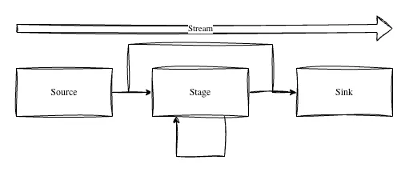
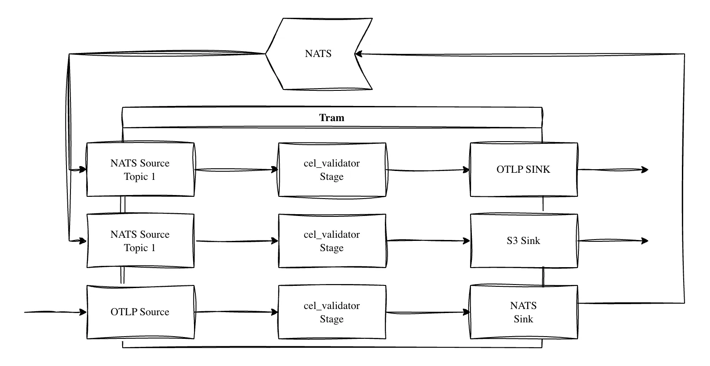

# Tram: A Lightweight, Extensible Data Pipeline Framework

Tram is a **cloud-native, in-memory data pipeline framework** for building real-time data processing flows. It enables developers to create, transform, and route data through **tree-structured pipelines** where each tree contains a source, optional stages, and sinks as leaves.

---

## ✨ Features

- **Tree-Based Pipelines**: Define complex data flows with a single source, optional stages, and multiple sinks as leaves
- **Cloud-Native**: Configure streams through the HTTP/gRPC API, JSON files, or Kubernetes custom resources; everything runs in memory
- **Extensible Architecture**: Easily add custom sources, stages, and sinks
- **Real-time Processing**: Event-driven architecture for low-latency data flows
- **OTLP-Native**: Logs, metrics and traces flow through pipelines as OpenTelemetry Protocol (OTLP) data


---

## 🚀 Quick Start

### Installation

```bash
git clone https://codeberg.org/eljoth/tram.git
cd tram
go build -o tram ./cmd/tram
```

Or build a container image with Docker or Podman: `task image:build` (with [Task](https://taskfile.dev)) or `docker build -t tram:dev .`. Run `task` to see all development tasks, e.g. for tests and benchmarks; [CONTRIBUTING.md](CONTRIBUTING.md#tasks) explains them.

### Run

```bash
./tram server
```

The container image starts the server with both APIs listening on all interfaces of the container: `docker run --rm -p 8080:8080 -p 50051:50051 tram:dev`.

By default the HTTP API listens on `localhost:8080` and the gRPC API on `localhost:50051`. `--log-level` sets the log level (`debug`, `info`, `warn` or `error`; default `info`). See `./tram server --help` for all flags.

### API Endpoints

The Tram service provides the following HTTP endpoints:

| Method | Endpoint | Description |
|--------|----------|-------------|
| GET | `/v1/streams` | List all streams, ordered by name |
| PUT | `/v1/streams/{name}` | Create or update a stream |
| GET | `/v1/streams/{name}` | Get a stream configuration |
| DELETE | `/v1/streams/{name}` | Delete a stream |

The stream name is taken from the URL; a `name` in the request body is replaced by it.

### Updating a Stream

A `PUT` to an existing stream changes as little as possible:

| Change | Effect |
|--------|--------|
| None | Nothing happens; the running stream is kept |
| Stages or sinks only | The new stages and sinks are created, events still in flight finish in the old ones, and the source switches over. The source keeps running, e.g. an OTLP source keeps its port open, and no event is lost |
| Source | The stream is stopped and created again. An OTLP source closes its port in between, so clients briefly cannot connect |

If an update fails, e.g. because of an invalid component spec, the request returns an error and the previous version of the stream keeps running. Delete and create a stream to restart it completely.

If the source of a stream stops on its own, e.g. because its NATS stream does not exist yet, Tram restarts the stream after a delay that grows from 1 second to 1 minute while it keeps failing. A `PUT` of the unchanged stream restarts it right away.

---

## 📡 Example API Usage

### Create a Simple Pipeline

This example creates a pipeline with:
- **Source**: `generator` (emits events every 5 seconds)
- **Stages**: None
- **Sinks**: `debug` (logs to stdout)

```bash
curl -X PUT http://localhost:8080/v1/streams/my-pipeline \
  -H "Content-Type: application/json" \
  -d '{
    "stream": {
      "name": "my-pipeline",
      "source": {
        "name": "event-generator",
        "type": "generator",
        "spec": {
          "interval": "5s"
        }
      },
      "sinks": [
        {
          "name": "console",
          "type": "debug",
          "from": "event-generator"
        }
      ]
    }
  }'
```

### Create a Pipeline with Stages

This example adds a `noop` stage between the source and sinks:

```bash
curl -X PUT http://localhost:8080/v1/streams/processing-pipeline \
  -H "Content-Type: application/json" \
  -d '{
    "stream": {
      "name": "processing-pipeline",
      "source": {
        "name": "events-source",
        "type": "generator",
        "spec": {
          "interval": "1s"
        }
      },
      "stages": [
        {
          "name": "passthrough",
          "type": "noop",
          "from": "events-source"
        }
      ],
      "sinks": [
        {
          "name": "console",
          "type": "debug",
          "from": "passthrough"
        }
      ]
    }
  }'
```

### Get Stream Configuration

```bash
curl http://localhost:8080/v1/streams/my-pipeline
```

### Delete a Stream

```bash
curl -X DELETE http://localhost:8080/v1/streams/my-pipeline
```

---

## 🏗️ Core Concepts

### Pipeline Structure

Streams follow a **tree structure** with these rules:

1. Each pipeline has **exactly one source** (root)
2. **Stages** can be connected to the source or other stages
3. **Sinks** must be connected to either the source or a stage
4. **All leaves must be sinks** (no dangling stages)



### Data Flow

```
Source → [Stage] → Sink
```

*Arrows represent the direction of data flow, from source to sinks.*

---

## 📋 Available Components

| Type | Components |
|------|-------------|
| **Sources** | `generator`, `nats`, `otlp` |
| **Stages** | `batch`, `cel_filter`, `cel_validator`, `delay`, `noop` |
| **Sinks** | `debug`, `nats` |

For detailed documentation on each component and its configuration, see [COMPONENTS.md](COMPONENTS.md).


---

## 🔧 Advanced Configuration

### Fan-out Pattern

Route data from a single source to multiple sinks. Every sink receives every event:

```bash
curl -X PUT http://localhost:8080/v1/streams/fanout-example \
  -H "Content-Type: application/json" \
  --data-binary @- <<'EOF'
{
  "stream": {
    "name": "fanout-example",
    "source": {
      "name": "otlp-in",
      "type": "otlp",
      "spec": { "http_port": 4318 }
    },
    "sinks": [
      {
        "name": "console",
        "type": "debug",
        "from": "otlp-in"
      },
      {
        "name": "archive",
        "type": "nats",
        "from": "otlp-in",
        "spec": {
          "url": "nats://localhost:4222",
          "stream": "telemetry",
          "subject": {
            "register": ["logs.>"],
            "logs": "'logs.' + logs.resource_logs[0].resource.attributes.get_attr('service.name')"
          }
        }
      }
    ]
  }
}
EOF
```

The `nats` sink needs a NATS server with JetStream enabled, e.g. `docker compose -f setup/nats/docker-compose.yaml up -d`.

### Chained Stages

Process data through multiple stages before reaching sinks:

```bash
curl -X PUT http://localhost:8080/v1/streams/chained-pipeline \
  -H "Content-Type: application/json" \
  -d '{
    "stream": {
      "name": "chained-pipeline",
      "source": {
        "name": "source",
        "type": "generator",
        "spec": { "interval": "1s" }
      },
      "stages": [
        {
          "name": "stage1",
          "type": "noop",
          "from": "source"
        },
        {
          "name": "stage2",
          "type": "noop",
          "from": "stage1"
        }
      ],
      "sinks": [
        {
          "name": "output",
          "type": "debug",
          "from": "stage2"
        }
      ]
    }
  }'
```

### Example Setup



---

## ⚙️ Configuration Sources

Besides the API, streams can be managed from two further sources. All of them change the same set of streams.

### File Sync

```bash
./tram server --enable-file-sync --config-directory config
```

Every `<name>.json` file in the directory describes one stream, in the same format as the API request body (`{"stream": {...}}`); see `setup/config/` for examples. The file name, without `.json`, is the stream name. The sync works in both directions:

- Adding, changing or deleting a file creates, updates or deletes the stream
- Streams created or changed through the API or the Kubernetes operator are written to files (new files are readable only by the owner, mode `0600`), and deleted streams have their file removed
- Streams without a file are deleted when the directory is synced

### Kubernetes Operator

```bash
kubectl apply -f internal/adapters/k8scrd/config/crd/bases/io.tram.core_streams.yaml
./tram server --enable-k8s-operator
```

The operator watches `Stream` resources (`io.tram.core/v1`) and runs each as a stream named `<namespace>.<name>`. It uses the in-cluster configuration or the current kubeconfig context; `--kubeconfig` selects another file. See `setup/k8s/` for an example and [the operator documentation](internal/adapters/k8scrd/README.md) for details.

---

## 🔒 Security

Tram has no authentication or authorization of its own. Whoever can create a stream decides which ports Tram opens and where it sends data, so treat access to every configuration source like access to the Tram process:

- **API**: the gRPC and HTTP APIs accept every request. They listen on `localhost` by default; if you bind them to other interfaces with `--grpc-endpoint` and `--http-endpoint`, restrict access, e.g. with a network policy or an authenticating proxy in front
- **OTLP source**: listens on the configured port on all network interfaces, without TLS or authentication. Anyone who can reach the port can send data into the stream. Restrict it on the network level, or terminate TLS and authenticate in a proxy in front of it
- **Sinks**: an OTLP sink sends data to any URL in its spec, and `insecure: true` turns off certificate checks. Keep credentials in sink specs, e.g. in `headers` or NATS URLs, out of version control; the file sync writes new files readable only by their owner
- **Kubernetes operator**: watches `Stream` resources in all namespaces, so everyone allowed to create a `Stream` in any namespace can open ports on the Tram pod and send data anywhere Tram can reach. Grant `create` on `streams.io.tram.core` only to users you would also trust with the Tram deployment

---

## 📖 Documentation

- **Components**: See [COMPONENTS.md](COMPONENTS.md) for detailed component documentation
- **Kubernetes Operator**: See [the operator documentation](internal/adapters/k8scrd/README.md)
- **Performance and Sizing**: See [BENCHMARK.md](BENCHMARK.md) for pipeline benchmarks and sizing guidance
- **Development**: See [CONTRIBUTING.md](CONTRIBUTING.md) for development and contribution guidelines

---

## 📜 License

Tram is licensed under the **MIT License** - see the [LICENSE](LICENSE) file for details.
