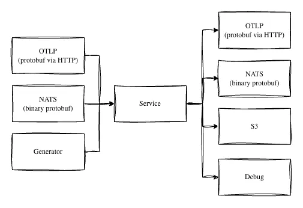

# Stream: A Lightweight, Extensible Data Pipeline Framework

Stream is a **cloud-native, in-memory data pipeline framework** for building real-time data processing flows. It enables developers to create, transform, and route data through **tree-structured pipelines** where each tree contains a source, optional stages, and sinks as leaves.

---

## ✨ Features

- **Tree-Based Pipelines**: Define complex data flows with a single source, optional stages, and multiple sinks as leaves
- **Cloud-Native**: Configuration managed entirely via API - no file-based configuration
- **Extensible Architecture**: Easily add custom sources, stages, and sinks
- **Real-time Processing**: Event-driven architecture for low-latency data flows
- **OTLP Support**: Designed for OpenTelemetry Protocol compatibility (future internal representation)


---

## 🚀 Quick Start

### Installation

```bash
git clone https://codeberg.org/eljoth/stream.git
cd stream
go build -o stream ./cmd/stream
```

### API Endpoints

The Stream service provides the following HTTP endpoints:

| Method | Endpoint | Description |
|--------|----------|-------------|
| PUT | `/v1/streams/{name}` | Create or update a stream |
| GET | `/v1/streams/{name}` | Get a stream configuration |
| DELETE | `/v1/streams/{name}` | Delete a stream |

---

## 📡 Example API Usage

### Create a Simple Pipeline

This example creates a pipeline with:
- **Source**: `generator` (emits events every 5 seconds)
- **Stages**: None
- **Sinks**: `debug` (logs to stdout), `nats` (publishes to NATS), `otlp` (sends to OTLP endpoint)

```bash
curl -X PUT http://localhost:8080/v1/streams/my-pipeline \
  -H "Content-Type: application/json" \
  -d '{
    "stream": {
      "name": "my-pipeline",
      "source": {
        "name": "event-generator",
        "type": "generator",
        "spec": {
          "interval": "5s"
        }
      },
      "sinks": [
        {
          "name": "console",
          "type": "debug",
          "from": "event-generator"
        },
        {
          "name": "nats-publisher",
          "type": "nats",
          "from": "event-generator",
          "spec": {
            "url": "nats://localhost:4222",
            "subject": "my-pipeline.events"
          }
        },
        {
          "name": "otlp-exporter",
          "type": "otlp",
          "from": "event-generator",
          "spec": {
            "endpoint": "http://localhost:4318",
            "insecure": true
          }
        }
      ]
    }
  }'
```

### Create a Pipeline with Stages

This example adds a `noop` stage between the source and sinks:

```bash
curl -X PUT http://localhost:8080/v1/streams/processing-pipeline \
  -H "Content-Type: application/json" \
  -d '{
    "stream": {
      "name": "processing-pipeline",
      "source": {
        "name": "events-source",
        "type": "generator",
        "spec": {
          "interval": "1s"
        }
      },
      "stages": [
        {
          "name": "passthrough",
          "type": "noop",
          "from": "events-source"
        }
      ],
      "sinks": [
        {
          "name": "storage",
          "type": "s3",
          "from": "passthrough",
          "spec": {
            "bucket": "my-events",
            "key_prefix": "processed/"
          }
        }
      ]
    }
  }'
```

### Get Stream Configuration

```bash
curl http://localhost:8080/v1/streams/my-pipeline
```

### Delete a Stream

```bash
curl -X DELETE http://localhost:8080/v1/streams/my-pipeline
```

---

## 🏗️ Core Concepts

### Pipeline Structure

Stream pipelines follow a **tree structure** with these rules:

1. Each pipeline has **exactly one source** (root)
2. **Stages** can be connected to the source or other stages
3. **Sinks** must be connected to either the source or a stage
4. **All leaves must be sinks** (no dangling stages)


### Data Flow

```
Source → [Stage] → Sink
```

*Arrows represent the direction of data flow, from source to sinks.*

---

## 📋 Available Components

| Type | Components |
|------|-------------|
| **Sources** | `generator`, `nats`, `otlp` |
| **Stages** | `noop` |
| **Sinks** | `debug`, `nats`, `otlp`, `s3` |

For detailed documentation on each component and its configuration, see [COMPONENTS.md](COMPONENTS.md).


---

## 🔧 Advanced Configuration

### Fan-out Pattern

Route data from a single source to multiple sinks:

```bash
curl -X PUT http://localhost:8080/v1/streams/fanout-example \
  -H "Content-Type: application/json" \
  -d '{
    "stream": {
      "name": "fanout-example",
      "source": {
        "name": "generator",
        "type": "generator",
        "spec": { "interval": "2s" }
      },
      "sinks": [
        {
          "name": "console",
          "type": "debug",
          "from": "generator"
        },
        {
          "name": "nats",
          "type": "nats",
          "from": "generator",
          "spec": {
            "url": "nats://localhost:4222",
            "subject": "fanout.events"
          }
        },
        {
          "name": "otlp",
          "type": "otlp",
          "from": "generator",
          "spec": {
            "endpoint": "http://localhost:4318"
          }
        }
      ]
    }
  }'
```

### Chained Stages

Process data through multiple stages before reaching sinks:

```bash
curl -X PUT http://localhost:8080/v1/streams/processing-pipeline \
  -H "Content-Type: application/json" \
  -d '{
    "stream": {
      "name": "processing",
      "source": {
        "name": "source",
        "type": "generator",
        "spec": { "interval": "1s" }
      },
      "stages": [
        {
          "name": "stage1",
          "type": "noop",
          "from": "source"
        },
        {
          "name": "stage2",
          "type": "noop",
          "from": "stage1"
        }
      ],
      "sinks": [
        {
          "name": "output",
          "type": "debug",
          "from": "stage2"
        }
      ]
    }
  }'
```

---

## 📖 Documentation

- **Components**: See [COMPONENTS.md](COMPONENTS.md) for detailed component documentation
- **Architecture**: See [ARCHITECTURE.md](ARCHITECTURE.md) for technical architecture details
- **Development**: See [CONTRIBUTING.md](CONTRIBUTING.md) for development and contribution guidelines

---

## 📜 License

Stream is licensed under the **MIT License** - see the [LICENSE](LICENSE) file for details.
